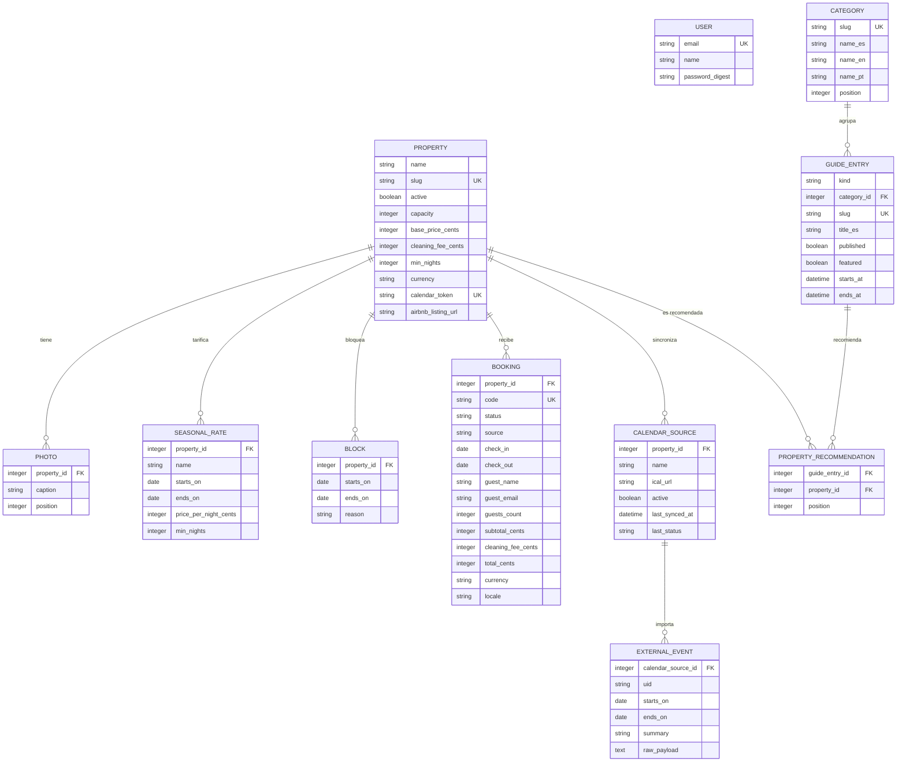
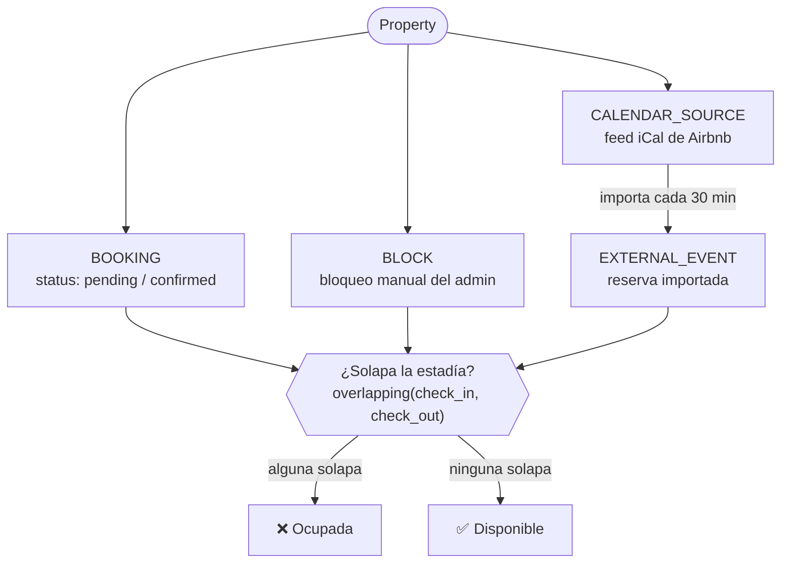
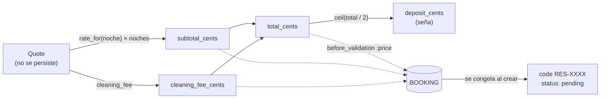

# Base de datos — Encar Stays

Esquema de la base de datos (SQLite). Fuente de verdad:
[db/schema.rb](../db/schema.rb). Todos los importes se guardan en **centavos**
(`*_cents`, unidades menores). Las columnas `*_es` / `*_en` / `*_pt` son contenido
traducible. Los rangos de fechas de ocupación son **semiabiertos** `[from, to)`:
el día de salida queda libre.

## Diagrama de entidades y relaciones

## Flujo: qué ocupa el calendario de una propiedad

Tres fuentes distintas quitan fechas del mercado. `Property#available?` está libre
solo cuando **ninguna** solapa la estadía.

## Flujo: del presupuesto a la reserva

> El presupuesto (`Quote`) se calcula al vuelo y **no** tiene tabla. Sus importes
> solo se graban cuando se convierten en un `Booking`, y a partir de ahí quedan
> congelados: cambiar tarifas de la propiedad no re-cotiza reservas existentes.

---

## Tablas

### `properties` — Propiedades

El agregado central. Cada propiedad es un alojamiento con su propio calendario,
precios y token de sincronización.

| Columna | Tipo | Notas |
|---|---|---|
| `name` | string | Requerido. |
| `slug` | string | Único. Autogenerado desde `name` (`parameterize`). URL param. |
| `active` | boolean | `true`. Solo las activas se listan/reservan. |
| `description` | text | |
| `address_area` | string | Zona/barrio. |
| `capacity` | integer | 2. Máx. huéspedes. |
| `bedrooms` / `beds` / `bathrooms` | integer | 1 / 1 / 1. |
| `base_price_cents` | integer | 0. Tarifa por noche por defecto. |
| `cleaning_fee_cents` | integer | 0. Tarifa de limpieza única. |
| `currency` | string | `PYG`. Inclusión en `%w[PYG USD]`. |
| `min_nights` | integer | 2. Mínimo de noches base. |
| `calendar_token` | string | Único. Token secreto del feed iCal saliente (`has_secure_token`). |
| `airbnb_listing_url` | string | Enlace al anuncio de Airbnb. |

Índices únicos: `slug`, `calendar_token`.

### `bookings` — Reservas

Solicitud de un huésped. Ocupa fechas mientras su estado es `pending` o
`confirmed`. Los importes se congelan al crearse.

| Columna | Tipo | Notas |
|---|---|---|
| `property_id` | integer | FK. |
| `code` | string | Único. `RES-XXXX` alfanumérico, generado al crear. Clave pública de la reserva. |
| `status` | string | enum: `pending` · `confirmed` · `completed` · `cancelled`. Def. `pending`. |
| `source` | string | enum: `direct` · `manual`. Def. `direct`. |
| `check_in` / `check_out` | date | Requeridos. Rango semiabierto. |
| `guest_name` / `guest_email` | string | Requeridos. |
| `guest_phone` | string | |
| `guests_count` | integer | 1. Validado contra `capacity`. |
| `subtotal_cents` / `cleaning_fee_cents` / `total_cents` | integer | 0. Precio congelado del presupuesto. |
| `currency` | string | `PYG`. |
| `locale` | string | `es`. Idioma en que reservó → sus emails salen en ese idioma. |
| `notes` | text | |
| `confirmed_at` / `cancelled_at` | datetime | Sellos de transición de estado. |

Índices: `code` (único), `property_id`, y compuesto `(property_id, status, check_in, check_out)` para consultas de solapamiento.

**Validaciones clave:** salida posterior a entrada, dentro de capacidad, cumple
mínimo de noches, y **fechas disponibles** (solo al crear). La creación pasa por
`Property#book!`, que envuelve el re-chequeo de disponibilidad y el insert en un
`with_lock` para evitar que dos huéspedes ganen las mismas fechas en una carrera.

### `seasonal_rates` — Tarifas de temporada

Sobrescriben el precio base (y opcionalmente el mínimo de noches) en un rango.

| Columna | Tipo | Notas |
|---|---|---|
| `property_id` | integer | FK. |
| `name` | string | Requerido (ej. "Temporada alta"). |
| `starts_on` / `ends_on` | date | Requeridos. Rango **inclusivo** en ambos extremos (`covering`). |
| `price_per_night_cents` | integer | 0. |
| `min_nights` | integer | Nullable. Sube el mínimo si es mayor al de la propiedad. |

Scope `covering(fecha)`: `starts_on <= fecha AND ends_on >= fecha`.

### `blocks` — Bloqueos manuales

Fechas cerradas por el admin (mantenimiento, uso propio, etc.). Ocupan mercado.

| Columna | Tipo | Notas |
|---|---|---|
| `property_id` | integer | FK. |
| `starts_on` / `ends_on` | date | Requeridos. Semiabierto `[from, to)`. |
| `reason` | string | Opcional; aparece como resumen en el feed iCal saliente. |

### `calendar_sources` — Fuentes de calendario

URL iCal de un calendario externo (típicamente Airbnb) a importar.

| Columna | Tipo | Notas |
|---|---|---|
| `property_id` | integer | FK. |
| `name` | string | `Airbnb`. |
| `ical_url` | string | Requerido. URL del `.ics`. |
| `active` | boolean | `true`. |
| `last_synced_at` | datetime | Última importación. |
| `last_status` | string | `ok` o `error: …`. Alimenta las alertas del dashboard. |

Scope `stale`: activa y sin sincronizar hace más de 2 horas.

### `external_events` — Eventos importados

Reservas ajenas traídas de una fuente iCal. Ocupan mercado igual que un booking.

| Columna | Tipo | Notas |
|---|---|---|
| `calendar_source_id` | integer | FK. |
| `uid` | string | Requerido. Único por fuente (upsert por UID). |
| `starts_on` / `ends_on` | date | Requeridos. Semiabierto. |
| `summary` | string | |
| `raw_payload` | text | El VEVENT original en iCal. |

Índice único `(calendar_source_id, uid)`.

### `photos` — Fotos

| Columna | Tipo | Notas |
|---|---|---|
| `property_id` | integer | FK. |
| `caption` | string | |
| `position` | integer | 0. Orden de galería. |

La imagen en sí es un adjunto de **Active Storage** (`has_one_attached :image`),
no una columna.

### `guide_entries` — Guía local (atracciones y eventos)

Contenido editorial multilingüe para promocionar la zona y cruzar con propiedades.

| Columna | Tipo | Notas |
|---|---|---|
| `kind` | string | `attraction` (por defecto) o `event`. |
| `category_id` | integer | FK opcional. |
| `slug` | string | Único. Autogenerado desde `title_es`. |
| `title_*` / `summary_*` / `description_*` / `schedule_note_*` | string/text | `_es` / `_en` / `_pt`. `title_es` requerido. |
| `published` / `featured` | boolean | `false`. |
| `area` / `address` | string | |
| `latitude` / `longitude` | decimal(10,6) | Mapa. |
| `external_url` | string | |
| `starts_at` / `ends_at` | datetime | Requerido `starts_at` si `kind = event`. |
| `recurring` | boolean | `false`. |
| `position` | integer | 0. |

Portada vía Active Storage (`has_one_attached :cover_image`).

### `categories` — Categorías de la guía

| Columna | Tipo | Notas |
|---|---|---|
| `slug` | string | Único. Autogenerado desde `name_es`. |
| `name_*` | string | `_es` / `_en` / `_pt`. `name_es` requerido. |
| `icon` | string | |
| `position` | integer | 0. |

### `property_recommendations` — Recomendaciones (N:M)

Une `GuideEntry` con `Property` para cross-promoción curada. Único
`(guide_entry_id, property_id)`, con `position` para el orden.

### `users` — Administradores

| Columna | Tipo | Notas |
|---|---|---|
| `email` | string | Único, requerido. |
| `name` | string | Requerido. |
| `password_digest` | string | `has_secure_password` (bcrypt). |

### Tablas de infraestructura

- `active_storage_attachments` / `active_storage_blobs` / `active_storage_variant_records`
  — adjuntos (fotos de propiedades, portadas de guía).
- Bases SQLite separadas en producción para Solid **Queue** (jobs), **Cache** y
  **Cable** (ver [config/database.yml](../config/database.yml)).
