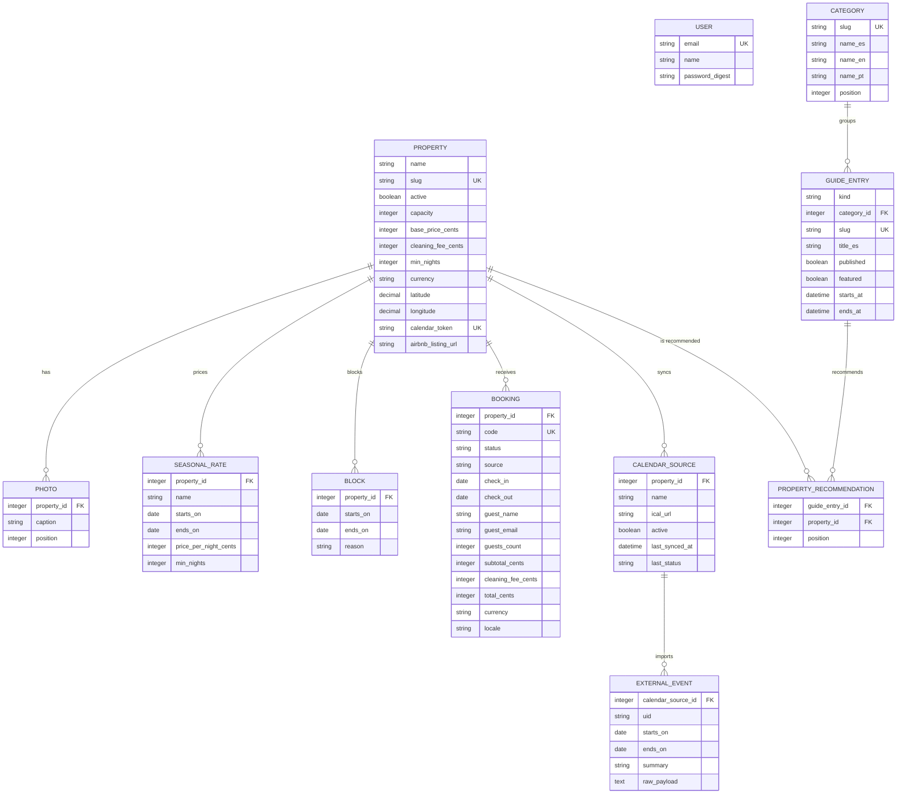
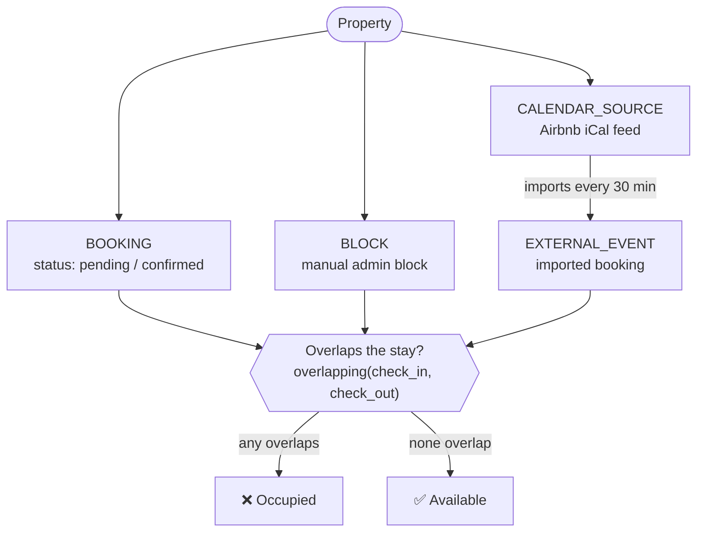
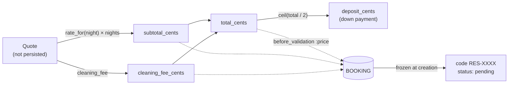

# Database — Encar Stays

The database schema (SQLite). Source of truth: [db/schema.rb](../db/schema.rb). All
amounts are stored in **cents** (`*_cents`, minor units). The `*_es` / `*_en` /
`*_pt` columns are translatable content. Occupancy date ranges are **half-open**
`[from, to)`: the check-out day stays free.

## Entity-relationship diagram

## Flow: what occupies a property's calendar

Three distinct sources take dates off the market. `Property#available?` is free only
when **none** of them overlap the stay.

## Flow: from quote to booking

> The quote (`Quote`) is calculated on the fly and has **no** table. Its amounts are
> only recorded when they turn into a `Booking`, and from then on they stay frozen:
> changing a property's rates does not re-quote existing bookings.

---

## Tables

### `properties` — Properties

The central aggregate. Each property is a rental with its own calendar, pricing, and
sync token.

| Column | Type | Notes |
|---|---|---|
| `name` | string | Required. |
| `slug` | string | Unique. Auto-generated from `name` (`parameterize`). URL param. |
| `active` | boolean | `true`. Only active ones are listed/booked. |
| `description` | text | |
| `address_area` | string | Area/neighborhood. |
| `latitude` / `longitude` | decimal(10,6) | Optional. Map pin + straight-line distance to attractions. |
| `capacity` | integer | 2. Max guests. |
| `bedrooms` / `beds` / `bathrooms` | integer | 1 / 1 / 1. |
| `base_price_cents` | integer | 0. Default per-night rate. |
| `cleaning_fee_cents` | integer | 0. One-time cleaning fee. |
| `currency` | string | `PYG`. Inclusion in `%w[PYG USD]`. |
| `min_nights` | integer | 2. Base minimum nights. |
| `calendar_token` | string | Unique. Secret token for the outbound iCal feed (`has_secure_token`). |
| `airbnb_listing_url` | string | Link to the Airbnb listing. |

Unique indexes: `slug`, `calendar_token`.

### `bookings` — Bookings

A guest's request. Occupies dates while its status is `pending` or `confirmed`.
Amounts are frozen at creation.

| Column | Type | Notes |
|---|---|---|
| `property_id` | integer | FK. |
| `code` | string | Unique. Alphanumeric `RES-XXXX`, generated on create. The booking's public key. |
| `status` | string | enum: `pending` · `confirmed` · `completed` · `cancelled`. Default `pending`. |
| `source` | string | enum: `direct` · `manual`. Default `direct`. |
| `check_in` / `check_out` | date | Required. Half-open range. |
| `guest_name` / `guest_email` | string | Required. |
| `guest_phone` | string | |
| `guests_count` | integer | 1. Validated against `capacity`. |
| `subtotal_cents` / `cleaning_fee_cents` / `total_cents` | integer | 0. Frozen quote price. |
| `currency` | string | `PYG`. |
| `locale` | string | `es`. Language they booked in → their emails go out in that language. |
| `notes` | text | |
| `confirmed_at` / `cancelled_at` | datetime | State-transition timestamps. |

Indexes: `code` (unique), `property_id`, and a composite `(property_id, status, check_in, check_out)` for overlap queries.

**Key validations:** check-out after check-in, within capacity, meets the minimum
nights, and **available dates** (on create only). Creation goes through
`Property#book!`, which wraps the availability re-check and the insert in a
`with_lock` to prevent two guests from winning the same dates in a race.

### `seasonal_rates` — Seasonal rates

Override the base price (and optionally the minimum nights) over a range.

| Column | Type | Notes |
|---|---|---|
| `property_id` | integer | FK. |
| `name` | string | Required (e.g. "High season"). |
| `starts_on` / `ends_on` | date | Required. **Inclusive** range on both ends (`covering`). |
| `price_per_night_cents` | integer | 0. |
| `min_nights` | integer | Nullable. Raises the minimum if greater than the property's. |

Scope `covering(date)`: `starts_on <= date AND ends_on >= date`.

### `blocks` — Manual blocks

Dates closed by the admin (maintenance, personal use, etc.). They occupy the market.

| Column | Type | Notes |
|---|---|---|
| `property_id` | integer | FK. |
| `starts_on` / `ends_on` | date | Required. Half-open `[from, to)`. |
| `reason` | string | Optional; appears as the summary in the outbound iCal feed. |

### `calendar_sources` — Calendar sources

The iCal URL of an external calendar (typically Airbnb) to import.

| Column | Type | Notes |
|---|---|---|
| `property_id` | integer | FK. |
| `name` | string | `Airbnb`. |
| `ical_url` | string | Required. URL of the `.ics`. |
| `active` | boolean | `true`. |
| `last_synced_at` | datetime | Last import. |
| `last_status` | string | `ok` or `error: …`. Feeds the dashboard alerts. |

Scope `stale`: active and not synced for more than 2 hours.

### `external_events` — Imported events

Third-party bookings pulled from an iCal source. They occupy the market just like a
booking.

| Column | Type | Notes |
|---|---|---|
| `calendar_source_id` | integer | FK. |
| `uid` | string | Required. Unique per source (upsert by UID). |
| `starts_on` / `ends_on` | date | Required. Half-open. |
| `summary` | string | |
| `raw_payload` | text | The original iCal VEVENT. |

Unique index `(calendar_source_id, uid)`.

### `photos` — Photos

| Column | Type | Notes |
|---|---|---|
| `property_id` | integer | FK. |
| `caption` | string | |
| `position` | integer | 0. Gallery order. |

The image itself is an **Active Storage** attachment (`has_one_attached :image`), not
a column.

### `guide_entries` — Local guide (attractions and events)

Multilingual editorial content to promote the area and cross-link with properties.

| Column | Type | Notes |
|---|---|---|
| `kind` | string | `attraction` (default) or `event`. |
| `category_id` | integer | Optional FK. |
| `slug` | string | Unique. Auto-generated from `title_es`. |
| `title_*` / `summary_*` / `description_*` / `schedule_note_*` | string/text | `_es` / `_en` / `_pt`. `title_es` required. |
| `published` / `featured` | boolean | `false`. |
| `area` / `address` | string | |
| `latitude` / `longitude` | decimal(10,6) | Map. |
| `external_url` | string | |
| `starts_at` / `ends_at` | datetime | `starts_at` required if `kind = event`. |
| `recurring` | boolean | `false`. |
| `position` | integer | 0. |

Cover image via Active Storage (`has_one_attached :cover_image`).

### `categories` — Guide categories

| Column | Type | Notes |
|---|---|---|
| `slug` | string | Unique. Auto-generated from `name_es`. |
| `name_*` | string | `_es` / `_en` / `_pt`. `name_es` required. |
| `icon` | string | |
| `position` | integer | 0. |

### `property_recommendations` — Recommendations (N:M)

Joins `GuideEntry` with `Property` for curated cross-promotion. Unique
`(guide_entry_id, property_id)`, with `position` for ordering.

### `users` — Admins

| Column | Type | Notes |
|---|---|---|
| `email` | string | Unique, required. |
| `name` | string | Required. |
| `password_digest` | string | `has_secure_password` (bcrypt). |

### Infrastructure tables

- `active_storage_attachments` / `active_storage_blobs` / `active_storage_variant_records`
  — attachments (property photos, guide cover images).
- Separate SQLite databases in production for Solid **Queue** (jobs), **Cache**, and
  **Cable** (see [config/database.yml](../config/database.yml)).
